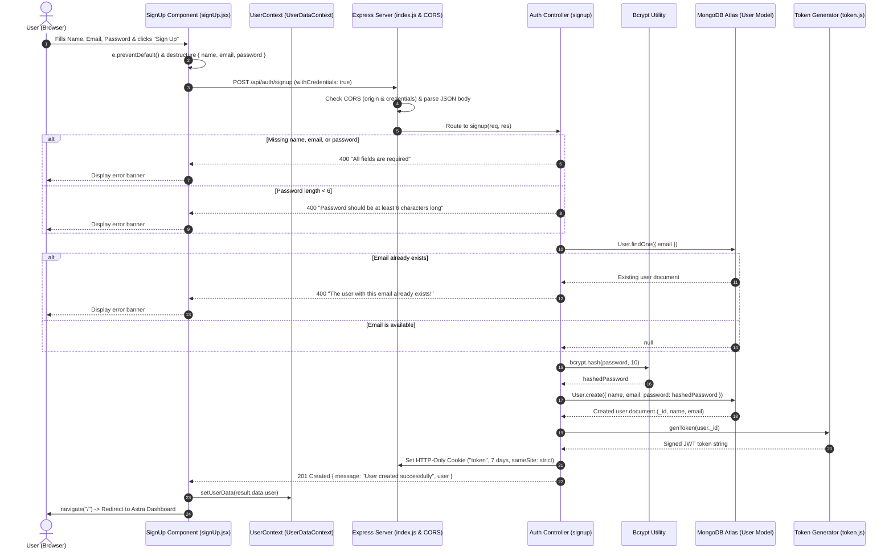
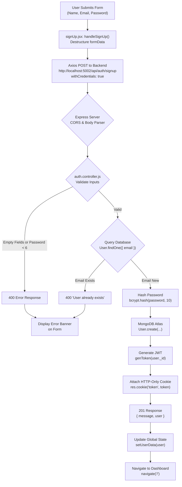
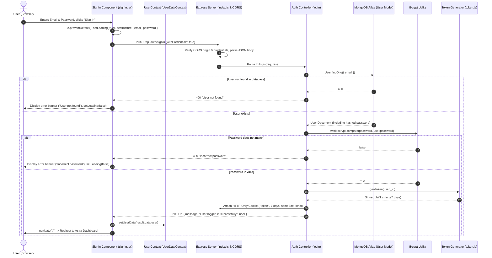
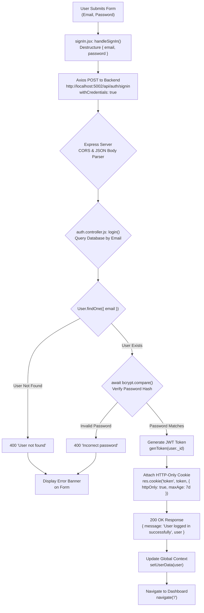

# ASTRA AI Virtual Assistant — Architecture, Technical Notes & Data Flows

> **Living Documentation**: This document tracks the end-to-end data flows, technical specifications, design patterns, and common pitfalls encountered in building the **Astra AI Virtual Assistant** (Full-Stack MERN: MongoDB, Express, React, Node.js).

---

## 1. Project Overview & Tech Stack

| Layer | Technology | Key Libraries / Frameworks |
| :--- | :--- | :--- |
| **Frontend** | React 19, Vite 8 | `react-router-dom` (v7), `@tailwindcss/vite` (v4), `axios`, `react-icons` |
| **Backend** | Node.js (ESM), Express 5 | `mongoose` (v9), `jsonwebtoken`, `bcryptjs`, `cookie-parser`, `cors`, `dotenv` |
| **Database** | MongoDB Atlas | Cloud-hosted MongoDB cluster with Mongoose ODM |
| **Media & Storage** | Cloudinary & Multer | *(Configured for future avatar and voice/image asset handling)* |

---

## 2. Directory Structure & Responsibilities

```text
astra-ai-assistance/
├── .gitignore                   # Ignores node_modules, .env, builds, uploads, OS files
├── NOTES.md                     # This file (Architecture & Technical Reference)
├── README.md                    # Project overview
│
├── backend/
│   ├── config/
│   │   ├── db.js                # MongoDB connection using Mongoose + dotenv
│   │   └── token.js             # JWT generation utility
│   ├── controllers/
│   │   └── auth.controller.js   # User registration, login, and logout logic
│   ├── middleware/              # Auth verification & file upload middlewares
│   ├── models/
│   │   └── user.model.js        # User Mongoose Schema (name, email, password)
│   ├── routes/
│   │   └── auth.routes.js       # Authentication route definitions (/api/auth)
│   ├── .env                     # Local environment secrets (ignored by Git)
│   ├── index.js                 # Express server bootstrap, middleware chain & routes
│   └── package.json             # Backend dependencies ("type": "module")
│
└── frontend/
    ├── src/
    │   ├── assets/              # Static media (background.png, icons)
    │   ├── context/
    │   │   └── UserContext.jsx  # Global user state (UserDataContext & UserContextProvider)
    │   ├── pages/
    │   │   ├── signUp.jsx       # Registration view (glassmorphism form)
    │   │   └── signIn.jsx       # Login view
    │   ├── App.jsx              # Client-side routing configuration
    │   ├── main.jsx             # React DOM root entry point + Context Provider wrapper
    │   └── index.css            # Tailwind CSS v4 entry point (@import "tailwindcss")
    ├── index.html
    ├── package.json             # Frontend dependencies
    └── vite.config.js           # Vite configuration with Tailwind CSS plugin
```

---

## 3. End-to-End Data Flows

### A. User Registration Flow (`/signup`)



#### Architecture Flowchart



---

### B. User Sign-In Flow (`/signin`)



#### Sign-In Architecture Flowchart



---

### C. Client State & Context Flow (`UserContext`)
```
[main.jsx] wraps entire app in <UserContextProvider>
       │
       ▼ Creates state: [userData, setUserData] = useState(null)
       ▼ Sets static config: serverUrl = "http://localhost:5002"
       │
       ▼ Provides { serverUrl, userData, setUserData } to <UserDataContext.Provider>
       │
       ├──> [signUp.jsx] consumes via useContext(UserDataContext)
       ├──> [signIn.jsx] consumes via useContext(UserDataContext)
       └──> [Future Chat / Dashboard] reads authenticated user info & sends AI prompts
```

---

## 4. Technicalities, Gotchas & Deep-Dive Notes

### 1. Module Systems: ES Modules vs. CommonJS
- **Rule**: `backend/package.json` specifies `"type": "module"`.
- **Nuance**: In an ES Module project, CommonJS globals like `require()`, `__dirname`, and `module.exports` are **not defined**.
- **Fix Applied**: Converted all backend files (such as `backend/config/db.js`) to use standard `import` and `export default` statements.

---

### 2. The Browser Global `window.name` Trap
- **The Issue**: In browser JavaScript, `window.name` is a built-in global property (which defaults to an empty string `""`).
- **The Pitfall**: In `signUp.jsx`, if you write `{ name, email, password }` inside `handleSignUp` without destructuring `const { name, email, password } = formData`, `name` does **not** trigger a `ReferenceError` like `email` does. Instead, it silently reads `window.name` (`""`).
- **The Consequence**: The backend validation check `if (!name || !email || !password)` continuously fails with `400 All fields are required`.
- **Rule**: Always explicitly destructure state:
  ```javascript
  const { name, email, password } = formData;
  ```

---

### 3. Context Naming & Consumer Separation in React
- **The Issue**: A React Context consists of two parts:
  1. The **Context Object** created by `createContext(null)`.
  2. The **Provider Component** which wraps children with `<Context.Provider value={...}>`.
- **The Pitfall**: If a file names its Provider component `UserContext` and default-exports it, developers will intuitively write `useContext(UserContext)`. Passing a React component to `useContext()` returns `undefined`, causing `serverUrl` and `setUserData` to be undefined.
- **Pattern Established**:
  - Context Object (Named Export): `export const UserDataContext = createContext(null);`
  - Provider Component (Default Export): `export default function UserContextProvider({ children })`
  - Consumer usage: `const { serverUrl } = useContext(UserDataContext);`

---

### 4. CORS with Authenticated Cookies (`withCredentials: true`)
- **The Issue**: When the frontend sends cookies or authorization headers via `axios` with `{ withCredentials: true }`, browser security rules strictly enforce:
  1. The backend **cannot** return a wildcard `Access-Control-Allow-Origin: *`.
  2. The backend must explicitly specify the exact client origin (e.g., `http://localhost:5173`).
  3. `Access-Control-Allow-Credentials` must be set to `true`.
- **Implementation in `backend/index.js`**:
  ```javascript
  app.use(cors({
      origin: process.env.CLIENT_URL || "http://localhost:5173",
      credentials: true
  }));
  ```

---

### 5. Asynchronous Password Verification (`bcrypt.compare`)
- **The Issue**: `bcrypt.compare()` is an asynchronous function that returns a **Promise**.
- **The Pitfall**: Writing `const matchedPassword = bcrypt.compare(password, hash)` without `await` stores a pending Promise object in `matchedPassword`. In JavaScript, all objects (including Promises) are truthy, meaning `if (!matchedPassword)` evaluates to `false`, and invalid passwords would authenticate!
- **Rule**: Always `await` the comparison:
  ```javascript
  const matchedPassword = await bcrypt.compare(password, user?.password);
  ```

---

### 6. Responsive Viewport Mechanics (`min-h-dvh` vs. Hardcoded Offsets)
- **The Issue**: Mobile browsers (iOS Safari, Android Chrome) have dynamic address bars that shrink and expand as the user scrolls, causing `100vh` to overflow and cut off content.
- **The Pitfall**: Hardcoding negative transform offsets (`-translate-x-20 -translate-y-20`) shifts content by a fixed 80px, causing the card to clip completely off-screen on phones and small tablets.
- **Pattern Applied**:
  - Use `min-h-screen min-h-dvh flex items-center justify-center p-4 sm:p-6 md:p-8` on the parent container.
  - Constrain the card with fluid width: `w-full max-w-[440px]`.
  - Let Flexbox calculate exact vertical and horizontal centering dynamically across all viewport sizes.

---

### 7. Modern Form Accessibility & Autofill (Web Standards)
- Forms use explicit `autoComplete` attributes:
  - Full Name: `autoComplete="name"`
  - Email: `autoComplete="email"` with `spellCheck="false"` (prevents browser autocorrecting email handles)
  - Sign-up Password: `autoComplete="new-password"`
  - Sign-in Password: `autoComplete="current-password"`
- Every `<input>` has a matching `<label htmlFor="id">` to ensure screen-reader compatibility and enlarge the clickable touch target.

---

### 8. `try...catch` Block Statement vs. `Promise.catch()` Method
- **The Issue**: In JavaScript, `try { ... } catch (error) { ... }` is a language **statement**, NOT an object or a function.
- **The Pitfall**: Writing `try { ... }.catch((err) => { ... })` attempts to call `.catch()` as a method on the `try` block's closing brace.
- **The Error**: JavaScript parsers throw `SyntaxError: Unexpected token '.'` or `'try' expected` / `Missing catch or finally after try`.
- **Rule**:
  - `try` blocks must be followed immediately by `catch (error) { ... }` or `finally { ... }` without a dot `.`.
  - `.catch()` is only for Promises (e.g. `promise.then().catch()`).
  ```javascript
  // ❌ Syntax Error
  try {
      await cloudinary.uploader.upload(...);
  }.catch((error) => { ... });

  // ✅ Valid JavaScript
  try {
      await cloudinary.uploader.upload(...);
  } catch (error) {
      console.error(error);
  }
  ```

---

## 5. API Reference & Contract

| Endpoint | Method | Headers / Auth | Request Body | Response (Success) | Description |
| :--- | :--- | :--- | :--- | :--- | :--- |
| `/` | `GET` | None | None | `"Astra AI Assistance API"` | API Health Check |
| `/api/auth/signup` | `POST` | None | `{ name, email, password }` | `201 Created`: `{ message, user }` + Set-Cookie | Creates user, hashes password, sets auth cookie |
| `/api/auth/signin` | `POST` | None | `{ email, password }` | `200 OK`: `{ message, user }` + Set-Cookie | Validates password, returns user data, sets auth cookie |
| `/api/auth/logout` | `GET` | Auth Cookie | None | `200 OK`: `{ message: "Logged out successfully" }` | Clears HTTP-only token cookie |
| `/api/auth/me` | `GET` | Auth Cookie | None | `200 OK`: `user` object | Validates JWT cookie and returns authenticated session |
| `/api/user/currentuser` | `GET` | Auth Cookie | None | `200 OK`: `user` object | Retrieves user profile with assistant details |
| `/api/user/update-assistant` | `POST` | Auth Cookie, Multipart | `FormData: { assistantName, assistantImage }` | `200 OK`: `{ message, user }` | Uploads avatar to Cloudinary & saves custom assistant persona |

---

## 6. Maintenance & Engineering Changelog

| Date | Category | Summary of Changes |
| :--- | :--- | :--- |
| **2026-11-10** | **Backend Structure** | Initialized standard MVC directory structure (`models`, `controllers`, `routes`, `config`, `middleware`). |
| **2026-11-10** | **Database** | Migrated `backend/config/db.js` to pure ES Modules; resolved MongoDB Atlas username template and connection string formatting. |
| **2026-11-10** | **Git Hygiene** | Added comprehensive root `.gitignore` protecting `node_modules`, `.env`, build outputs, and local uploads. |
| **2026-11-13** | **Frontend Layout** | Refactored `signUp.jsx` layout using modern responsive Flexbox centering (`min-h-dvh`, `p-4 sm:p-8`), removing breaking `-translate` offsets. |
| **2026-11-14** | **State & Auth** | Refactored `UserContext.jsx` into `UserDataContext` and `UserContextProvider`. Added global user state. Fixed global `window.name` trap in signup. |
| **2026-11-14** | **Backend Security** | Added `await` to `bcrypt.compare` in login controller; updated CORS to support credentials; corrected cookie flags to `httpOnly: true`. |
| **2026-11-14** | **Frontend Pages** | Implemented responsive `signIn.jsx` with Astra branding, accessible autofill, password toggle, and error banner feedback. |
| **2026-11-17** | **Cloudinary & Persona** | Rectified `try...catch` syntax in `cloudinary.js`. Added Multer storage middleware and `/api/user/update-assistant` route. |
| **2026-11-17** | **App Routing & Dashboard** | Fixed hook and JSX syntax errors in `App.jsx`. Added `Home.jsx` (assistant chat) and `Customize.jsx` (persona setup). Built routing guards. |
| **2026-11-17** | **Agent Assets & Switcher** | Imported and configured 4 local agent avatars (`agent1.png` to `agent4.png`) across `Customize.jsx` and `Home.jsx` with active preview switching. |
| **2026-11-17** | **Customize & Home UI Redesign** | Transformed Customize Assistant into a spacious 2×2 grid of large (180–220px) rounded-rectangle cards for Astra Nova, Elara, Orion, and Auron with glowing gold borders, fixed names, matching custom upload card, and upgraded the Home dashboard UI. |

