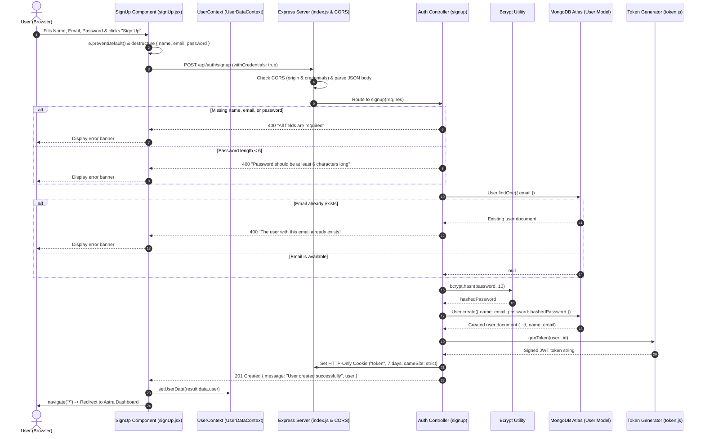
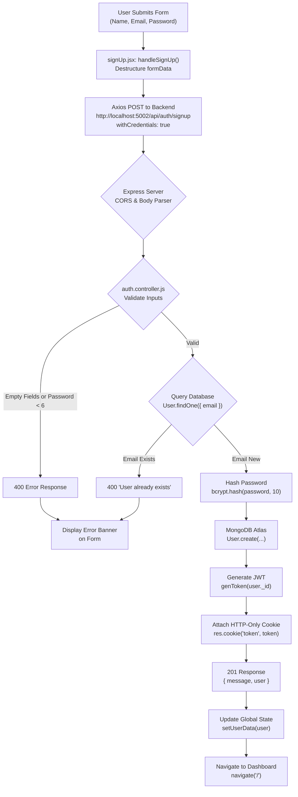
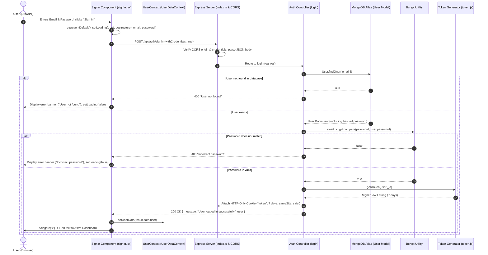
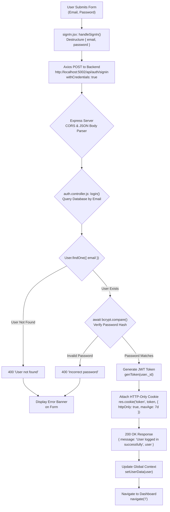

# ASTRA AI Virtual Assistant — Architecture, Technical Notes & Data Flows

> **Living Documentation**: This document tracks the end-to-end data flows, technical specifications, design patterns, and common pitfalls encountered in building the **Astra AI Virtual Assistant** (Full-Stack MERN: MongoDB, Express, React, Node.js).

---

## 1. Project Overview & Tech Stack

| Layer | Technology | Key Libraries / Frameworks |
| :--- | :--- | :--- |
| **Frontend** | React 19, Vite 8 | `react-router-dom` (v7), `@tailwindcss/vite` (v4), `axios`, `react-icons` |
| **Backend** | Node.js (ESM), Express 5 | `mongoose` (v9), `jsonwebtoken`, `bcryptjs`, `cookie-parser`, `cors`, `dotenv` |
| **Database** | MongoDB Atlas | Cloud-hosted MongoDB cluster with Mongoose ODM |
| **Media & Storage** | Cloudinary & Multer | *(Configured for future avatar and voice/image asset handling)* |

---

## 2. Directory Structure & Responsibilities

```text
astra-ai-assistance/
├── .gitignore                   # Ignores node_modules, .env, builds, uploads, OS files
├── NOTES.md                     # This file (Architecture & Technical Reference)
├── README.md                    # Project overview
│
├── backend/
│   ├── config/
│   │   ├── db.js                # MongoDB connection using Mongoose + dotenv
│   │   └── token.js             # JWT generation utility
│   ├── controllers/
│   │   └── auth.controller.js   # User registration, login, and logout logic
│   ├── middleware/              # Auth verification & file upload middlewares
│   ├── models/
│   │   └── user.model.js        # User Mongoose Schema (name, email, password)
│   ├── routes/
│   │   └── auth.routes.js       # Authentication route definitions (/api/auth)
│   ├── .env                     # Local environment secrets (ignored by Git)
│   ├── index.js                 # Express server bootstrap, middleware chain & routes
│   └── package.json             # Backend dependencies ("type": "module")
│
└── frontend/
    ├── src/
    │   ├── assets/              # Static media (background.png, icons)
    │   ├── context/
    │   │   └── UserContext.jsx  # Global user state (UserDataContext & UserContextProvider)
    │   ├── pages/
    │   │   ├── signUp.jsx       # Registration view (glassmorphism form)
    │   │   └── signIn.jsx       # Login view
    │   ├── App.jsx              # Client-side routing configuration
    │   ├── main.jsx             # React DOM root entry point + Context Provider wrapper
    │   └── index.css            # Tailwind CSS v4 entry point (@import "tailwindcss")
    ├── index.html
    ├── package.json             # Frontend dependencies
    └── vite.config.js           # Vite configuration with Tailwind CSS plugin
```

---

## 3. End-to-End Data Flows

### A. User Registration Flow (`/signup`)



#### Architecture Flowchart



---

### B. User Sign-In Flow (`/signin`)



#### Sign-In Architecture Flowchart



---

### C. Client State & Context Flow (`UserContext`)
```
[main.jsx] wraps entire app in <UserContextProvider>
       │
       ▼ Creates state: [userData, setUserData] = useState(null)
       ▼ Sets static config: serverUrl = "http://localhost:5002"
       │
       ▼ Provides { serverUrl, userData, setUserData } to <UserDataContext.Provider>
       │
       ├──> [signUp.jsx] consumes via useContext(UserDataContext)
       ├──> [signIn.jsx] consumes via useContext(UserDataContext)
       └──> [Future Chat / Dashboard] reads authenticated user info & sends AI prompts
```

---

## 4. Technicalities, Gotchas & Deep-Dive Notes

### 1. Module Systems: ES Modules vs. CommonJS
- **Rule**: `backend/package.json` specifies `"type": "module"`.
- **Nuance**: In an ES Module project, CommonJS globals like `require()`, `__dirname`, and `module.exports` are **not defined**.
- **Fix Applied**: Converted all backend files (such as `backend/config/db.js`) to use standard `import` and `export default` statements.

---

### 2. The Browser Global `window.name` Trap
- **The Issue**: In browser JavaScript, `window.name` is a built-in global property (which defaults to an empty string `""`).
- **The Pitfall**: In `signUp.jsx`, if you write `{ name, email, password }` inside `handleSignUp` without destructuring `const { name, email, password } = formData`, `name` does **not** trigger a `ReferenceError` like `email` does. Instead, it silently reads `window.name` (`""`).
- **The Consequence**: The backend validation check `if (!name || !email || !password)` continuously fails with `400 All fields are required`.
- **Rule**: Always explicitly destructure state:
  ```javascript
  const { name, email, password } = formData;
  ```

---

### 3. Context Naming & Consumer Separation in React
- **The Issue**: A React Context consists of two parts:
  1. The **Context Object** created by `createContext(null)`.
  2. The **Provider Component** which wraps children with `<Context.Provider value={...}>`.
- **The Pitfall**: If a file names its Provider component `UserContext` and default-exports it, developers will intuitively write `useContext(UserContext)`. Passing a React component to `useContext()` returns `undefined`, causing `serverUrl` and `setUserData` to be undefined.
- **Pattern Established**:
  - Context Object (Named Export): `export const UserDataContext = createContext(null);`
  - Provider Component (Default Export): `export default function UserContextProvider({ children })`
  - Consumer usage: `const { serverUrl } = useContext(UserDataContext);`

---

### 4. CORS with Authenticated Cookies (`withCredentials: true`)
- **The Issue**: When the frontend sends cookies or authorization headers via `axios` with `{ withCredentials: true }`, browser security rules strictly enforce:
  1. The backend **cannot** return a wildcard `Access-Control-Allow-Origin: *`.
  2. The backend must explicitly specify the exact client origin (e.g., `http://localhost:5173`).
  3. `Access-Control-Allow-Credentials` must be set to `true`.
- **Implementation in `backend/index.js`**:
  ```javascript
  app.use(cors({
      origin: process.env.CLIENT_URL || "http://localhost:5173",
      credentials: true
  }));
  ```

---

### 5. Asynchronous Password Verification (`bcrypt.compare`)
- **The Issue**: `bcrypt.compare()` is an asynchronous function that returns a **Promise**.
- **The Pitfall**: Writing `const matchedPassword = bcrypt.compare(password, hash)` without `await` stores a pending Promise object in `matchedPassword`. In JavaScript, all objects (including Promises) are truthy, meaning `if (!matchedPassword)` evaluates to `false`, and invalid passwords would authenticate!
- **Rule**: Always `await` the comparison:
  ```javascript
  const matchedPassword = await bcrypt.compare(password, user?.password);
  ```

---

### 6. Responsive Viewport Mechanics (`min-h-dvh` vs. Hardcoded Offsets)
- **The Issue**: Mobile browsers (iOS Safari, Android Chrome) have dynamic address bars that shrink and expand as the user scrolls, causing `100vh` to overflow and cut off content.
- **The Pitfall**: Hardcoding negative transform offsets (`-translate-x-20 -translate-y-20`) shifts content by a fixed 80px, causing the card to clip completely off-screen on phones and small tablets.
- **Pattern Applied**:
  - Use `min-h-screen min-h-dvh flex items-center justify-center p-4 sm:p-6 md:p-8` on the parent container.
  - Constrain the card with fluid width: `w-full max-w-[440px]`.
  - Let Flexbox calculate exact vertical and horizontal centering dynamically across all viewport sizes.

---

### 7. Modern Form Accessibility & Autofill (Web Standards)
- Forms use explicit `autoComplete` attributes:
  - Full Name: `autoComplete="name"`
  - Email: `autoComplete="email"` with `spellCheck="false"` (prevents browser autocorrecting email handles)
  - Sign-up Password: `autoComplete="new-password"`
  - Sign-in Password: `autoComplete="current-password"`
- Every `<input>` has a matching `<label htmlFor="id">` to ensure screen-reader compatibility and enlarge the clickable touch target.

---

### 8. `try...catch` Block Statement vs. `Promise.catch()` Method
- **The Issue**: In JavaScript, `try { ... } catch (error) { ... }` is a language **statement**, NOT an object or a function.
- **The Pitfall**: Writing `try { ... }.catch((err) => { ... })` attempts to call `.catch()` as a method on the `try` block's closing brace.
- **The Error**: JavaScript parsers throw `SyntaxError: Unexpected token '.'` or `'try' expected` / `Missing catch or finally after try`.
- **Rule**:
  - `try` blocks must be followed immediately by `catch (error) { ... }` or `finally { ... }` without a dot `.`.
  - `.catch()` is only for Promises (e.g. `promise.then().catch()`).
  ```javascript
  // ❌ Syntax Error
  try {
      await cloudinary.uploader.upload(...);
  }.catch((error) => { ... });

  // ✅ Valid JavaScript
  try {
      await cloudinary.uploader.upload(...);
  } catch (error) {
      console.error(error);
  }
  ```

### 9. Google Gemini API URL Formatting & Duplicate Query Parameters
- **The Issue**: When copying the sample REST endpoint from Google AI Studio / Google GenAI documentation, the snippet URL often includes the placeholder query param:
  `https://generativelanguage.googleapis.com/v1beta/models/gemini-3.8-flash:generateContent?key=YOUR_API_KEY`
- **The Pitfall**: Storing this complete URL in `.env` as `GEMINI_API_URL` while simultaneously storing `GEMINI_API_KEY` causes `gemini.js` to do:
  ```javascript
  const result = await axios.post(`${api_url}?key=${api_key}`, ...);
  ```
- **The Consequence**: The request URL evaluates to:
  `.../generateContent?key=AQ...I_AQ?key=AQ...I_AQ`
  The parser sees `?key=` appended to the existing key value, destroying the key string and causing Google's server to return `400 Bad Request: "API key not valid. Please pass a valid API key."`.
- **The Fix**:
  1. Set `GEMINI_API_URL` to the base endpoint without query parameters:
     `GEMINI_API_URL="https://generativelanguage.googleapis.com/v1beta/models/gemini-3.8-flash:generateContent"`
  2. In `gemini.js`, sanitize the URL with `rawUrl.split("?")[0]` before appending `?key=${apiKey}` to prevent accidental duplicate parameters.

### 10. Natural Language Intent Routing & Temporal Precision (`askAstra` + `moment`)
- **The Architecture**: Rather than simply echoing text, `askAstra` uses Google Gemini as a semantic classifier that returns structured JSON indicating user intent:
  - Temporal Queries: `"get_date"`, `"get_time"`, `"get_day"`, `"get_month"`, `"get_year"`
  - Web & Media Automations: `"google_search"`, `"youtube_search"`, `"youtube_play"`
  - Application Navigation: `"calculator_open"`, `"instagram_open"`, `"facebook_open"`, `"weather-show"`
  - Open-ended conversation: `"general"`
- **Why `moment` is Used**: LLMs do not inherently know real-time wall-clock time without tool use or grounding. When Gemini classifies an intent as `get_time` or `get_date`, the backend intercepts this and uses `moment()` to resolve the exact real-time local date/time (`moment().format("MMM D, YYYY")`, `moment().format("hh:mm A")`).
- **Resilient JSON Parsing**:
  LLMs sometimes output conversational text or wrap JSON in Markdown code fences (` ```json ... ``` `). The backend sanitizes the output with `.replace(/```json/gi, "").replace(/```/g, "")` and applies the regex `/\{[\s\S]*\}/` to extract the payload safely. If parsing fails, it gracefully falls back to returning the raw response as a `"general"` reply without throwing a 500 error.

### 11. Single Default Export Rule in JavaScript ES Modules
- **The Issue**: In JavaScript (ES6+ Modules), each module/file is allowed to have at most **one** `export default`.
- **The Pitfall**: In `frontend/src/context/UserContext.jsx`, the file defined:
  ```javascript
  export default function UserContextProvider({ children }) { ... }
  ```
  and then at the bottom of the file added:
  ```javascript
  export default geminiResponse;
  ```
- **The Error**: JavaScript compilers (Vite, Rollup, Babel, TypeScript) throw `SyntaxError: A module cannot have multiple default exports`.
- **The Secondary Scope Bug**: `serverUrl` had been defined locally inside `UserContextProvider`, so a helper function placed outside the component could not access `serverUrl` (causing `ReferenceError: serverUrl is not defined`).
- **The Fix**:
  1. Kept `UserContextProvider` as the single default export so `main.jsx` can wrap the app tree without breakage.
  2. Promoted `serverUrl` to module scope so all functions in the file can access it.
  3. Exported `geminiResponse` as a named export (`export const geminiResponse = ...`) and also injected it into the `UserDataContext` provider `value` object.

### 12. Compound Intent Deconstruction & Web Speech API Troubleshooting
- **Multi-Action Pipeline Architecture**:
  To support compound voice statements (such as *"open Instagram and tell me the time"*), `backend/gemini.js` instructs Gemini to return a structured `actions: [...]` array. `askAstra` in `backend/controllers/user.controller.js` iterates through each action sequentially:
  - Resolving temporal actions (`get_time`, `get_date`) via `moment`.
  - Compiling browser redirect targets (`urls: [...]`) for web actions (`instagram_open`, `youtube_play`, `google_search`).
  - Merging action voice fragments into a unified natural spoken sentence.
  - Supporting backward compatibility by accepting both array `actions: [...]` and legacy single-intent `type` objects.
- **Web Speech API `network` Error**:
  - In Chromium browsers, `webkitSpeechRecognition` streams raw audio frames to Google's cloud speech recognition endpoints.
  - When Chrome returns `event.error = 'network'`, it indicates that the cloud speech WebSocket was refused or blocked.
  - Primary causes:
    1. **Brave Browser Privacy Shields**: Brave blocks Google speech telemetry by default. (Fix: turn shields off for `localhost` and enable Google services in `brave://settings/extensions`).
    2. **VPN / Proxy / Ad-Blockers**: Network filters intercept or sever Google's streaming audio sockets.
    3. **DNS / Host Resolution**: Sometimes `127.0.0.1:5173` routes more reliably than `localhost:5173` on macOS.
  - Added an in-app dismissible banner in `frontend/src/pages/Home.jsx` to inform users of network/permission status without requiring DevTools.

### 13. Session-Based Conversation History Architecture (`User.history[sessionSchema]`)
- **The Design**: Rather than storing raw strings in `history: [String]`, the User model uses nested Mongoose subdocuments:
  ```javascript
  messageSchema: { role, content, type, urls, timestamp }
  sessionSchema: { sessionId, title, startedAt, messages: [messageSchema] }
  userSchema.history: [sessionSchema]
  ```
- **Active Session Tracking**:
  - `askAstra` accepts `{ command, sessionId }`.
  - If `sessionId` is passed and found, messages are appended to that session.
  - If `sessionId` is omitted or new, a session is automatically initialized with an auto-truncated title (e.g., `command.slice(0, 32)`).
  - Both the user prompt turn and the assistant response turn are recorded synchronously into `session.messages`.
- **Transmission Archives UI**:
  - `GET /api/user/history` returns lightweight session summaries (`messageCount`, `lastMessage`, `startedAt`) without bloated message bodies.
  - `GET /api/user/history/:sessionId` returns full message arrays when opening an archived conversation.
  - A slide-over celestial drawer in `frontend/src/pages/Home.jsx` provides one-click switching between historical sessions, creating new transmissions, or deleting specific archives.

### 14. Mongoose Schema Migration Pitfall (`Tried to set nested object field 'history' to primitive value`)
- **The Symptom**: When sending a message or querying user data, Mongoose throws:
  `ValidatorError: Tried to set nested object field 'history' to primitive value 'hello'`.
- **The Root Cause**:
  Under the earlier schema, `userSchema.history` was defined as `[{ type: String }]` (or `[String]`). When commands like `"hello"` were sent previously, MongoDB Atlas stored primitive strings in the user document: `history: ["hello", ...]`.
  When the schema was upgraded to `history: [sessionSchema]`, Mongoose attempted to cast existing strings in the database into embedded subdocuments (`{ sessionId, title, startedAt, messages }`).
  Because `"hello"` is a primitive string and not an object, Mongoose's Document caster triggers an `ObjectExpectedError` during `doc.init()` when reading from MongoDB, and `user.save()` fails validation with `ValidatorError: Tried to set nested object field 'history' to primitive value 'hello'`.
- **The Resolution**:
  1. **Mongoose `pre('init')` Hook**:
     Added a pre-init hook on `userSchema` in `backend/models/user.model.js`. This intercepts the raw document directly from MongoDB before Mongoose casts it into a model. Any legacy strings are automatically converted on-the-fly into valid `sessionSchema` objects (e.g. `{ sessionId: ..., title: "hello", messages: [{ role: "user", content: "hello" }] }`), eliminating casting errors during document hydration.
  2. **Defensive Filtering in Controllers**:
     In `backend/controllers/user.controller.js` (`askAstra`, `getChatHistory`, `getSessionMessages`, `deleteSession`), added defensive checks ensuring `user.history` is an array and filtering out any non-object items before operating on or saving the document.
  3. **Standalone Migration Script (`backend/migrate-history.js`)**:
     Created a native MongoDB migration script accessible via `npm run migrate:history` that scans the `users` collection and updates legacy documents directly in MongoDB Atlas.

### 15. Cinematic 2-Column Dashboard Redesign (`Home.jsx`)
- **Architecture**: Refactored the assistant dashboard from a traditional vertical chat screen into a majestic 2-column cosmic command center inspired by visual mockups:
  - **Left Sidebar Dock**:
    - Branded with `ASTRA AI Companion` and 4-point golden star emblem.
    - Navigation: `Home` (active pill), `Conversations` (archives drawer toggle), `Persona` (`/customize` link).
    - Excluded non-essential items (`Tools` and `Settings`).
    - Dynamic `Recent Conversations` list connected to `GET /api/user/history` with session titles, relative timestamps, and one-click session loading.
    - Clean user profile footer with avatar, name, and logout (no Pro Member badge).
  - **Central Celestial Stage**:
    - Persona Selection: Automatically defaults to **Elara** (`agent2.png`) as the primary female persona and **Orion** (`agent3.png`) as the male persona (or custom user-uploaded avatar), with dynamic tracking typography (`ELARA` / `ORION`).
    - Rotating concentric orbital rings with planetary beads and pulsing starlight glow.
    - 20-bar animated golden equalizer waveform and real-time status indicator (`Speaking...`, `Listening...`, `Synthesizing...`, `Standing by...`).
    - Dynamic response / subtitle capsule with external action links.
    - Tri-button control pedestal:
      1. Keyboard toggle button (reveals floating text prompt bar with suggestion chips).
      2. Large glowing golden microphone button (`toggleSpeechRecognition`).
      3. Stop / cancel button (halts speech synthesis and speech recognition).
    - Slide-over Conversations Archive Drawer for full transcript inspection and session management.

### 16. Strict Vocal Gender Association Engine & Custom Persona Voice Selector
- **The Requirement**: Female voices must strictly accompany **Elara** (with a sweet, crisp, clear vocal quality) and male voices must accompany **Orion**. For custom user personas, an interactive voice profile selector (Male vs. Female) must dictate vocal synthesis.
- **The "Albert" Fallback Bug on macOS**:
  - In macOS SpeechSynthesis, system voices are listed alphabetically: `Albert`, `Alice`, `Alva`, `Amélie`...
  - `Albert` is a male robotic novelty voice that lacks the string `"male"` or `"alex"`.
  - When a generic negative fallback (`!maleRegex.test(v.name)`) ran, `Albert` was erroneously matched as the first voice for female personas, producing a male robotic voice.
- **The Sweet, Crisp Voice Hierarchy for Elara**:
  - Replaced negative heuristics with a curated priority array:
    1. **`Samantha`**: macOS flagship sweet, crisp, crystal-clear natural female voice (Siri timbre).
    2. **`Google UK English Female`** & **`Victoria`**: Sweet, refined British female voices.
    3. **`Google US English`** & **`Karen`**: Natural conversational clear female voices.
  - Added `MALE_NOVELTY_BLACKLIST` explicitly banning `albert`, `alex`, `fred`, `daniel`, `david`, `ralph`, `bad news`, `zarvox`, etc. from ever being assigned to female personas.
  - Sweet voice pitch calibration: `utterance.pitch = 1.05`, `utterance.rate = 1.0`.
- **The Standard Voice Hierarchy for Orion**:
  - Standard browser male voice priority: `Daniel`, `Alex`, `Google UK English Male`, `David`.
  - Grounded pitch calibration: `utterance.pitch = 0.92`, `utterance.rate = 1.0`.
- **Custom Persona UI (`Customize.jsx`) & Backend Persistence**:
  - Added interactive `Voice Profile` toggle buttons (`♀ Female Voice` / `♂ Male Voice`) in the custom persona form.
  - Persisted `assistantGender: { type: String, enum: ["female", "male"], default: "female" }` in `userSchema` and `updateAssistant` controller.

---

## 5. Google Gemini AI Engineering Masterclass & Deep Dive

> **Essential Learning for Software Engineers & Students**: This section breaks down the foundational patterns, architectural mechanics, and common traps when integrating Google Gemini (and Large Language Models in general) into a production full-stack application.

```
+-----------------------------------------------------------------------------------------------------+
|                                FULL-STACK AI ORCHESTRATION PIPELINE                                 |
+-----------------------------------------------------------------------------------------------------+
|                                                                                                     |
|  [ FRONTEND ]                                                                                       |
|   User Voice / Text Query: "Who was the president before him and open Instagram"                   |
|         │                                                                                           |
|         ▼ (HTTP POST /api/user/ask-astra { command, sessionId })                                    |
|                                                                                                     |
|  [ BACKEND: user.controller.js ]                                                                    |
|   1. Query MongoDB for active Session: session.messages                                             |
|   2. Extract Sliding Memory Window: (session.messages).slice(-8)                                    |
|   3. Construct Augmented Context: User Identity + Assistant Persona + Prior Turns                  |
|         │                                                                                           |
|         ▼ (Direct HTTPS POST to Gemini API :generateContent)                                        |
|                                                                                                     |
|  [ GOOGLE GEMINI LLM: gemini-2.5-flash ]                                                            |
|   1. Resolves Anaphora ("him" -> references prior turn context)                                     |
|   2. Deconstructs Compound Intents -> Actions Array                                                 |
|   3. Returns Strict JSON Contract: { actions: [...], response: "..." }                              |
|         │                                                                                           |
|         ▼                                                                                           |
|                                                                                                     |
|  [ BACKEND: Intent Execution Engine ]                                                               |
|   1. Action 1: "general" -> Keep factual answer ("Barack Obama served prior to...")                 |
|   2. Action 2: "instagram_open" -> Generate URL ("https://instagram.com")                          |
|   3. Synthesis: Merge spoken responses & persist turns to MongoDB Atlas                             |
|         │                                                                                           |
|         ▼ (HTTP 200 { response, urls, actions, sessionId })                                         |
|                                                                                                     |
|  [ FRONTEND ]                                                                                       |
|   1. Text-to-Speech: Synthesize voice response in browser via Web Speech API                        |
|   2. Action Trigger: Open URL in new window/tab                                                     |
|   3. UI Updates: Display subtitle pill & waveform animation                                         |
+-----------------------------------------------------------------------------------------------------+
```

### 1. The Core Paradigm: Probabilistic Models vs. Deterministic Backends
- **What an LLM Actually Is**: An LLM is not a database, an operating system, or a deterministic state machine. It is a probabilistic text predictor trained to generate the most statistically probable next tokens given an input context window.
- **The Orchestrator's Job**: A production web backend (Node.js/Express) serves as the **deterministic orchestrator**. The backend's responsibility is to:
  1. Constrain the LLM's output format into structured, parseable data (JSON).
  2. Intercept tasks the LLM cannot do accurately (e.g. real-time wall clock time, database updates, browser navigation).
  3. Execute deterministic side-effects (opening URLs, calculating timestamps, persisting database records).

---

### 2. The Stateless Fallacy & The Architecture of Conversational Memory
- **The Rule**: LLMs are **100% stateless**. HTTP requests to `v1beta/models/...:generateContent` are completely independent. The Gemini API does not "remember" who you are or what you asked two seconds ago.
- **The "Illusion of Continuous Memory"**: To make an AI feel like a personal companion that remembers context, the orchestrator must maintain state in a database (MongoDB Atlas) and feed previous conversation turns back into the prompt on every request.
- **The Sliding Window Pattern**:
  - *Anti-Pattern*: Sending the user's entire lifetime history (e.g. 500 messages). This causes context window overflow, explosive token billing costs, and high latency (Time To First Token - TTFT).
  - *Best Practice*: Slicing the most recent turns (`(session.messages || []).slice(-8)`). This provides immediate conversational continuity (resolving pronouns like *"who was before him?"* or *"what did I ask earlier?"*) while keeping token payloads compact.

```javascript
// backend/controllers/user.controller.js
// Extract the last 8 messages for contextual recall
const recentHistory = (session.messages || []).slice(-8);

// Pass history into the LLM prompt generator
const result = await geminiResponse(command, assistantName, userName, recentHistory);
```

---

### 3. Structured Output Contracts & The Deterministic Parsing Pipeline
- **The Challenge**: If you prompt an LLM naturally, it will reply with conversational pleasantries, markdown bolding (`**`), bullet points, and code fences (` ```json `). A backend cannot reliably pass raw conversational prose into an automated system.
- **The Solution: Strict JSON Contracts**:
  We enforce a strict JSON output schema in the system prompt:
  ```json
  {
      "actions": [
          {
              "type": "general" | "google_search" | "youtube_search" | "get_time" | "instagram_open",
              "userinput": "<clean argument>"
          }
      ],
      "response": "<spoken voice reply>"
  }
  ```
- **Defensive Production Parsing**:
  Never assume the model's output will pass `JSON.parse()` cleanly. In production:
  1. Strip Markdown fences: `.replace(/```json/gi, "").replace(/```/g, "").trim()`.
  2. Extract JSON with regex: `.match(/\{[\s\S]*\}/)` to isolate the object even if the model outputs trailing or leading chatter.
  3. Try/Catch Fallback: If `JSON.parse` fails, fall back to treating the text as a `"general"` reply rather than throwing an unhandled 500 error to the client.

---

### 4. The "Placeholder Stalling" Anti-Pattern & Prompt Engineering
- **The Bug**: When asked *"Who is the President of the United States?"*, the assistant previously replied: *"I can help with that, let me look into it"* and then went silent.
- **Why This Happened**:
  Because the prompt included tools like `"google_search"`, and the instruction for `"response"` said:
  *`"A conversational spoken reply that confirms all requested actions (e.g. 'Opening Instagram now, and checking the current time.')"`*
  The model classified the query as something that required searching, generated a placeholder acknowledgment, and expected an external system to perform the search.
- **The Engineering Rule**:
  You must clearly decouple **Direct Knowledge Questions** from **External Tool Actions**:
  - **Direct Knowledge (`type: "general"`)**: Instruct the model that for all questions seeking facts, explanations, or concepts, it **must provide the direct, complete answer immediately** in `response`.
  - **Tool Actions (`type: "google_search"`, etc.)**: Only trigger search actions when the user explicitly uses keywords like *"search Google for"* or *"google"*.

---

### 5. Grounding Real-Time Temporal Queries (LLM Hallucinations vs. System Clock)
- **Why LLMs Cannot Tell Time**:
  LLMs do not have an internal clock or access to the host operating system. If you ask Gemini *"What time is it?"* without grounding, it will either hallucinate a random time, use its training cutoff timestamp, or state that it cannot tell time.
- **The Hybrid Grounding Pattern**:
  1. Let Gemini act as a **semantic router**: It classifies *"what time is it"* as `type: "get_time"`.
  2. The Node.js backend intercepts `get_time`:
     ```javascript
     case "get_time": {
         const timeStr = moment().format("hh:mm A");
         voiceFragments.push(`The time is ${timeStr}.`);
         break;
     }
     ```
  3. The system returns the exact, real-time local wall-clock time with zero hallucination.

---

### 6. Compound Intent Deconstruction (Multi-Action Pipeline)
- **Single vs. Compound Prompts**:
  Real users speak in compound sentences: *"Astra, open Instagram and tell me what day it is."*
- **Deconstruction Pattern**:
  Instead of forcing the LLM to choose one single `type`, we instruct Gemini to return an `actions: [...]` array:
  ```json
  {
      "actions": [
          { "type": "instagram_open", "userinput": "instagram" },
          { "type": "get_day", "userinput": "day" }
      ],
      "response": "Opening Instagram now, and today is Saturday."
  }
  ```
- The backend iterates through the array, opens `https://instagram.com`, resolves the current day via `moment().format("dddd")`, and joins the spoken fragments into a cohesive spoken experience.

---

### 7. Security, Environment Hygiene & API Key Sanitization
- **Client-Side vs. Server-Side Keys**: Never expose `GEMINI_API_KEY` on the frontend (Vite/React). All Gemini calls must originate from your authenticated Node.js backend to prevent key theft, quota exhaustion, and billing abuse.
- **URL Parameter Trap**:
  In `.env` configurations, some developers paste the full URL including `?key=...`. If the backend interpolates `${process.env.GEMINI_API_URL}?key=${process.env.GEMINI_API_KEY}`, you end up with:
  `.../generateContent?key=...&key=...` which Google rejects as an invalid API key. Always sanitize endpoints with `rawUrl.split("?")[0]`.

---

## 6. API Reference & Contract

| Endpoint | Method | Headers / Auth | Request Body | Response (Success) | Description |
| :--- | :--- | :--- | :--- | :--- | :--- |
| `/` | `GET` | None | None | `"Astra AI Assistance API"` | API Health Check |
| `/api/auth/signup` | `POST` | None | `{ name, email, password }` | `201 Created`: `{ message, user }` + Set-Cookie | Creates user, hashes password, sets auth cookie |
| `/api/auth/signin` | `POST` | None | `{ email, password }` | `200 OK`: `{ message, user }` + Set-Cookie | Validates password, returns user data, sets auth cookie |
| `/api/auth/logout` | `GET` | Auth Cookie | None | `200 OK`: `{ message: "Logged out successfully" }` | Clears HTTP-only token cookie |
| `/api/auth/me` | `GET` | Auth Cookie | None | `200 OK`: `user` object | Validates JWT cookie and returns authenticated session |
| `/api/user/currentuser` | `GET` | Auth Cookie | None | `200 OK`: `user` object | Retrieves user profile with assistant details |
| `/api/user/update-assistant` | `POST` | Auth Cookie, Multipart | `FormData: { assistantName, assistantImage }` | `200 OK`: `{ message, user }` | Uploads avatar to Cloudinary & saves custom assistant persona |
| `/api/user/ask-astra` | `POST` | Auth Cookie | `{ command, sessionId }` | `200 OK`: `{ success, sessionId, type, content, response, actions, urls }` | Multi-action intent processing & session turn persistence |
| `/api/user/history` | `GET` | Auth Cookie | None | `200 OK`: `{ success, sessions: [...] }` | Summarized list of archived sessions |
| `/api/user/history/:sessionId` | `GET` | Auth Cookie | None | `200 OK`: `{ success, session: { messages: [...] } }` | Full transcript of a single session |
| `/api/user/history/:sessionId` | `DELETE` | Auth Cookie | None | `200 OK`: `{ success, message }` | Deletes a single archived session |
| `/api/user/history` | `DELETE` | Auth Cookie | None | `200 OK`: `{ success, message }` | Clears all archived sessions |

---

## 7. Maintenance & Engineering Changelog

| Date | Category | Summary of Changes |
| :--- | :--- | :--- |
| **2026-11-10** | **Backend Structure** | Initialized standard MVC directory structure (`models`, `controllers`, `routes`, `config`, `middleware`). |
| **2026-11-10** | **Database** | Migrated `backend/config/db.js` to pure ES Modules; resolved MongoDB Atlas username template and connection string formatting. |
| **2026-11-10** | **Git Hygiene** | Added comprehensive root `.gitignore` protecting `node_modules`, `.env`, build outputs, and local uploads. |
| **2026-11-13** | **Frontend Layout** | Refactored `signUp.jsx` layout using modern responsive Flexbox centering (`min-h-dvh`, `p-4 sm:p-8`), removing breaking `-translate` offsets. |
| **2026-11-14** | **State & Auth** | Refactored `UserContext.jsx` into `UserDataContext` and `UserContextProvider`. Added global user state. Fixed global `window.name` trap in signup. |
| **2026-11-14** | **Backend Security** | Added `await` to `bcrypt.compare` in login controller; updated CORS to support credentials; corrected cookie flags to `httpOnly: true`. |
| **2026-11-14** | **Frontend Pages** | Implemented responsive `signIn.jsx` with Astra branding, accessible autofill, password toggle, and error banner feedback. |
| **2026-11-17** | **Cloudinary & Persona** | Rectified `try...catch` syntax in `cloudinary.js`. Added Multer storage middleware and `/api/user/update-assistant` route. |
| **2026-11-17** | **App Routing & Dashboard** | Fixed hook and JSX syntax errors in `App.jsx`. Added `Home.jsx` (assistant chat) and `Customize.jsx` (persona setup). Built routing guards. |
| **2026-11-17** | **Agent Assets & Switcher** | Imported and configured 4 local agent avatars (`agent1.png` to `agent4.png`) across `Customize.jsx` and `Home.jsx` with active preview switching. |
| **2026-11-17** | **Customize & Home UI Redesign** | Transformed Customize Assistant into a spacious 2×2 grid of large (180–220px) rounded-rectangle cards for Astra Nova, Elara, Orion, and Auron with glowing gold borders, fixed names, matching custom upload card, and upgraded the Home dashboard UI. |
| **2026-11-17** | **Documentation** | Authored full production README.md featuring architecture breakdown, tech badges, directory tree, setup guide, API reference, security patterns, and links to living notes. |
| **2026-11-17** | **AI Pipeline & Gemini** | Resolved "API key is invalid" error in `gemini.js` caused by duplicated `?key=` query parameters when combining `GEMINI_API_URL` with `GEMINI_API_KEY`. Added URL sanitization and direct dotenv bootstrapping. |
| **2026-11-18** | **AI Pipeline & Intent Routing** | Verified `moment` package, fixed recursive template variable in `gemini.js`, implemented comprehensive `askAstra` controller with intent routing and real-time temporal formatting, mounted `/api/user/ask-astra` route, and wired speech synthesis in `Home.jsx`. |
| **2026-11-19** | **Frontend Module Fix** | Resolved "A module cannot have multiple default exports" in `UserContext.jsx` by retaining `UserContextProvider` as default export, hoisting `serverUrl` to module scope, and providing `geminiResponse` as both a named export and context value. |
| **2026-11-20** | **Compound Actions & Speech Robustness** | Upgraded Gemini prompt and `askAstra` controller to support compound multi-action statements (`actions` array), unified spoken replies, and added in-app speech error diagnostics in `Home.jsx`. |
| **2026-11-20** | **Session History & Archives** | Redesigned `User.history` into nested `sessionSchema` subdocuments recording full user & assistant conversation turns. Built session CRUD endpoints and added a slide-over Transmission Archives drawer with session loading, switching, and purging. |
| **2026-11-20** | **Schema Migration & Self-Healing** | Fixed `ValidatorError: Tried to set nested object field 'history' to primitive value` by adding Mongoose `pre('init')` and `pre('validate')` hooks to seamlessly convert legacy primitive strings (`["hello"]`) in MongoDB into structured session subdocuments, adding defensive controller filtering, and providing `migrate-history.js`. |
| **2026-11-21** | **Cinematic Home Dashboard** | Transformed `Home.jsx` into a 2-column cosmic dashboard: left sidebar dock (Home, Conversations, Persona, Recent Transmissions, user profile without Pro badge), hero stage with rotating orbital rings, Elara/Orion persona switching, dynamic audio waveform, response capsule, and tri-button control pedestal (Keyboard, Mic, Stop). |
| **2026-11-21** | **Gemini Knowledge & Multi-Turn Memory** | Resolved placeholder stalling bug by strictly enforcing direct factual answers in `response` for `general` queries; enabled multi-turn session memory by passing sliding history window (`(session.messages).slice(-8)`) from `askAstra` to `geminiResponse`; added comprehensive Gemini AI Engineering Masterclass section to `NOTES.md`. |
| **2026-11-21** | **Strict Vocal Gender & Custom Persona Voice** | Implemented strict voice association: female voice for Elara and male voice for Orion; added Male/Female voice selector in `Customize.jsx` for custom personas; updated `User.assistantGender` in backend; added voice caching and calibrated pitch tuning (`0.88` male, `1.08` female). |
| **2026-11-21** | **Web Speech API Root Cause & Bulletproof Engine** | Diagnosed and permanently fixed the male voice bug for Elara: removed misclassified `Google US English` from female whitelist, enforced strict male blacklisting, solved the Chromium async `getVoices()` race condition with auto-retry, added interactive voice preview in `Customize.jsx`, and migrated legacy database records. |

---

## 8. Web Speech API Deep Dive: Female Voice Selection Architecture & Root Cause Analysis

> **Critical Frontend & Browser Audio Engineering Guide**: This section documents the exact technical mechanics behind browser speech synthesis (`window.speechSynthesis`), why browsers (especially Google Chrome on macOS) default to male voices, and how to construct a bulletproof voice engine.

### 8.1 The Root Cause Diagnosis: Why Elara Spoke with a Male Voice

When investigating why Elara (and female personas) continued speaking in a male voice despite prior pitch adjustments, four distinct browser and code-level factors were uncovered:

```
+----------------------------------------------------------------------------------------------------+
|                           THE SPEECH SYNTHESIS GENDER FAILURE CHAIN                                |
+----------------------------------------------------------------------------------------------------+
|                                                                                                    |
|  1. CHROME VOICE MISCLASSIFICATION TRAP                                                            |
|     * In Google Chrome, "Google US English" is a MALE synthesizer voice.                           |
|     * The whitelist had placed "Google US English" under PREFERRED_FEMALE_VOICES.                  |
|     * Chrome matched this entry immediately and forced Elara to speak with a male voice!           |
|                                                                                                    |
|  2. MALE BLACKLIST OMISSION                                                                        |
|     * While Alex, Daniel, and Fred were blacklisted, "Google US English" was omitted.              |
|     * In any fallback search, Chrome naturally returned "Google US English" as its first English   |
|       voice, guaranteeing a male voice every time.                                                 |
|                                                                                                    |
|  3. CHROMIUM ASYNCHRONOUS GETVOICES() RACE CONDITION                                               |
|     * window.speechSynthesis.getVoices() returns an empty array [] on initial page mount.          |
|     * If speech synthesis executes before onvoiceschanged populates, utterance.voice is null.      |
|     * When utterance.voice is null, the OS plays its default voice (Alex on macOS, which is male). |
|                                                                                                    |
|  4. PITCH TUNING LIMITATIONS                                                                       |
|     * Setting utterance.pitch = 1.05 does NOT alter vocal tract formants or timbre.                |
|     * It simply pitches up the male vocal model, sounding like an unnatural high-frequency male.   |
|                                                                                                    |
+----------------------------------------------------------------------------------------------------+
```

### 8.2 The Resilient Multi-Tier Vocal Engine (`speechVoice.js`)

To permanently eliminate this issue across all operating systems (macOS, Windows, Linux, iOS, Android) and browsers (Chrome, Safari, Edge, Firefox), we engineered a dedicated vocal pipeline with the following principles:

1. **Strictly Verified Female Voice Priority**:
   - `Google UK English Female` (Google Chrome's crisp British female voice)
   - `Samantha` (macOS flagship sweet, clear, friendly American female voice)
   - `Victoria`, `Karen`, `Moira`, `Tessa`, `Kathy`, `Serena`, `Ava`, `Allison`, `Susan`, `Veena`
   - `Microsoft Jenny (Natural)`, `Microsoft Aria (Natural)`, `Microsoft Zira`
2. **Exhaustive Male & Novelty Voice Blacklist for Female Personas**:
   - Strictly blocks: `google us english`, `alex`, `daniel`, `david`, `fred`, `albert`, `george`, `oliver`, `ralph`, `rishi`, `thomas`, `tom`, `mark`, `guy`, `richard`, `james`, `male`, `man\b`, `boy`, and all macOS novelty voices (`bad news`, `bahh`, `bells`, `boing`, `bubbles`, `cellos`, `good news`, `jester`, `junior`, `organ`, `superstar`, `trinoids`, `whisper`, `wobble`, `zarvox`).
3. **Chromium Async Voice Loading Retry Mechanism**:
   - If `getVoices()` returns `[]`, the engine automatically retries up to 3 times (150ms apart) until voices are hydrated, ensuring `utterance.voice` is never `undefined`.
4. **Explicit Locale Binding**:
   - Sets `utterance.lang = selectedVoice.lang || "en-US"`, preventing the browser from defaulting to unexpected OS locale voices.
5. **Calibrated Vocal Acoustics**:
   - **Elara / Female**: `pitch: 1.15`, `rate: 1.0` (crisp, sweet, melodic, articulate).
   - **Orion / Male**: `pitch: 0.92`, `rate: 1.0` (grounded, steady, analytical).
6. **Live Interactive Voice Preview in UI**:
   - Added a "Hear Voice 🔊" button directly on both the Preset cards (Elara / Orion) and Custom Persona form in `/customize` so users can instantly audit and verify the synthesized voice with zero guesswork.


